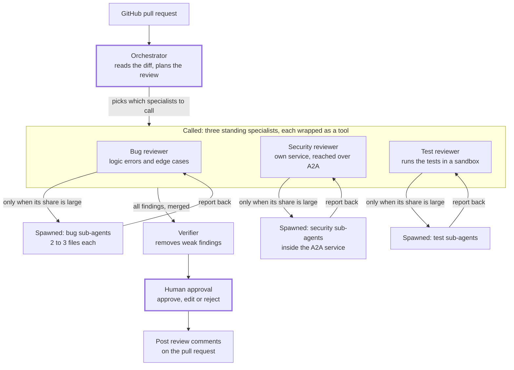
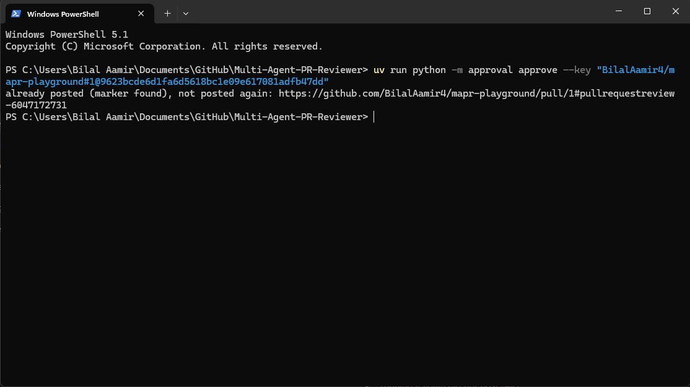
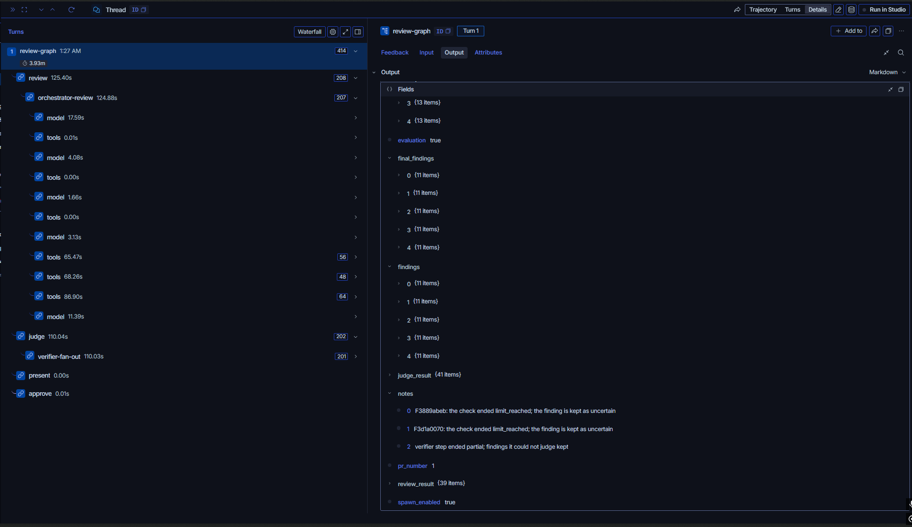

# Multi-Agent-PR-Reviewer

A LangChain/LangGraph system that reviews Python pull requests with several cooperating agents,
plus an evaluation of whether that finds more planted bugs than a single agent.

## Architecture



Human approval and posting are built as a CLI (`approval/`, decision 0016) and were run once on a real PR (see "Human approval and posting").

## What is built

- An orchestrator that plans the review and calls three specialists (bug, security, test) as tools.
- The security specialist as an A2A service (a separate process, local transport by default in the
  evaluation).
- Specialists that spawn sub-agents with LangGraph `Send` when their share of the diff is large.
- A verifier and an orchestrator-as-judge that keep or drop findings (they never edit them).
- A Docker sandbox: PR code only ever runs `pytest` inside a throwaway container with no network.
- A quota-aware model router with per-call retries, and LangSmith tracing.
- A 20-item dataset of real commits with planted bugs (14 planted items with 28 bugs, 6 clean), a
  strict scorer, and a blind-labelling protocol for judging unmatched findings.
- Human approval (LangGraph `interrupt`), SQLite-checkpointed resume and idempotent GitHub posting of
  the approved findings as review comments (`python -m approval`, stage 6).

## Not built yet

- The GitHub webhook service and Postgres checkpoints (both left out on purpose, from the plan's
  cut list; the CLI posts and SQLite stores the checkpoints).
- Hardening (stage 7) is next.
- The stage 5 evaluation is not finished (see Results).

## Human approval and posting

This is a portfolio project, not a product. `python -m approval review-pr` runs the review graph
(review, judge, present) on a real pull request and stops at a LangGraph `interrupt` with the findings.
`approve` asks per finding: approve, edit (title, explanation, severity only) or reject. State is
checkpointed in SQLite, so `resume` continues after a crash from the last finished node. Posting uses
a least-privilege fine-grained token and one GitHub review: findings on changed diff lines become
inline comments, the rest go in the summary. A hidden marker in the review body stops a second
posting.

Live run (2026-11-25) on a small test repository: the review reached the interrupt with 5 findings; a
killed-and-resumed copy continued after the review step without re-running it; I approved all 5 after
checking them against the diff; one review with 5 inline comments was posted
(https://github.com/BilalAamir4/mapr-playground/pull/1#pullrequestreview-6047172731); running `approve`
again printed "already posted (marker found)" and posted nothing. Edit and reject were covered by unit
tests only, not by the live run. Details: `docs/decisions/0016-human-approval-and-posting.md`.

## Demo

- Test pull request: https://github.com/BilalAamir4/mapr-playground/pull/1
- Double-post check: `docs/media/double-post-check.png`
- LangSmith trace: `docs/media/trace.png`
- Screen recording of the approval step: not recorded yet. Save it as `docs/media/approval-demo.mp4`
  (or `.gif`) and link it here.




## Running it

```powershell
uv sync
uv run pytest -q -m "not integration"
uv run reviewer review --workspace PATH --diff PATH [--title TEXT] [--body-file PATH] [--out PATH]
uv run reviewer review --agent orchestrator --workspace PATH --diff PATH [--sandbox-repo NAME]
uv run reviewer review --agent graph --judge verifier --workspace PATH --diff PATH
uv run python -m approval review-pr --repo OWNER/NAME --pr N   # then approve, status, resume
uv run python -m eval.run --config single      # review and score every dataset item
uv run python -m eval.plan_runs                # status of the evaluation runs
uv run python -m eval.report                   # eval/results/REPORT.md and the table below
```

It needs Python 3.12, `uv`, Docker Desktop and the keys in `.env` (see `.env.example`). The design is
in `docs/plan.md`, the evaluation protocol in `docs/decisions/0015-evaluation-protocol.md`.

## Results (interim)

Every role uses Gemini 3.1 Flash Lite (free tier), one run per configuration, 20 items with 28
planted bugs. Recall and precision use the strict matching rule, with location-only recall beside
it. Adjusted precision stays empty until the blind labelling is done. Median time has rate-limit
waiting removed, with the waiting beside it. Cost is the price estimate; nothing was billed.
Only the first two rows are complete. The other rows were paused by a Gemini API outage on Nov 24
(503 high demand) and will resume with the same model. With 28 bugs and one run each, small
differences are not conclusive.

| Configuration | Recall | Precision (strict / adjusted) | False alarms per clean PR | Cost per review | Median time |
| --- | --- | --- | --- | --- | --- |
| One agent | 0.07 (location-only 0.14) | 0.50 / - | 0.00 | $0.0194 (75K input, 415 output tokens) | 14.3 s (+35.3 s waiting) |
| Orchestrator calling specialists | 0.36 (location-only 0.43) | 0.67 / - | 0.17 | $0.0429 (164K input, 1249 output tokens) | 45.6 s (+76.5 s waiting) |
| Plus spawned sub-agents on large diffs | in progress: paused by a Gemini API outage on Nov 24 (503 high demand); same model, will resume | | | | |
| Plus verifier | in progress: paused by a Gemini API outage on Nov 24 (503 high demand); same model, will resume | | | | |
| Plus orchestrator as judge (optional) | in progress: paused by a Gemini API outage on Nov 24 (503 high demand); same model, will resume | | | | |

Details: `eval/results/REPORT.md` (cost, time, per-size and per-kind tables).
