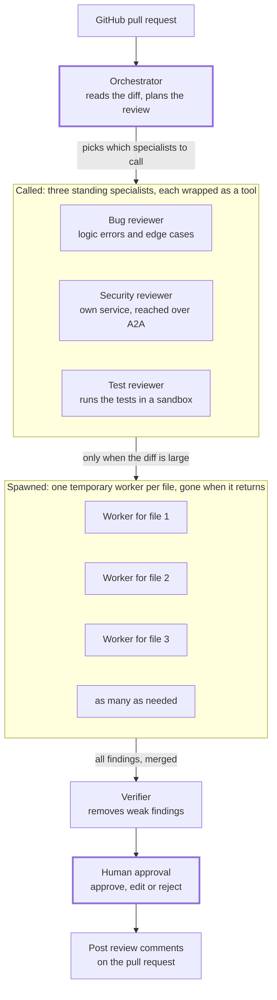

# PR review agent: project plan

Nov 16, 2026 · @Bilal · Updated Nov 19, 2026 with locked decisions

## What you are building

A service that reviews a GitHub pull request the way a small team would. One orchestrator agent reads the change, calls specialist reviewer agents, spawns extra workers when the change is large, checks every finding, and posts comments only after a person approves.

The project answers one question with numbers: does splitting a review across several agents find more real bugs than one agent, and what does that cost in money and time?

Scope is Python repositories only. The repository is `Multi-Agent-PR-Reviewer`.

## What it covers

Every skill an agent role asks about maps to a visible part of the project.

| Skill | Where the project shows it |
| --- | --- |
| Tool design and tool calling | Tools to read files, search code, read the diff, run linters and run tests |
| Structured output | Every finding is a validated object: file, lines, category, severity, evidence |
| Planning and routing | The orchestrator decides which specialists a change needs |
| An agent calling other agents | Three standing specialists, each wrapped as a tool the orchestrator calls |
| An agent spawning sub-agents | Temporary workers created at run time, one per file, for large diffs |
| Agents across systems | One specialist runs as its own service and is called over the A2A protocol |
| Self-checking | A verifier agent re-reads each finding against the code and drops weak ones |
| Human in the loop | The run pauses before posting; a person approves, edits or rejects |
| State and recovery | Checkpoints let a crashed or paused review resume where it stopped |
| Evaluation | A dataset of pull requests with planted bugs, scored for recall and precision |
| Observability | Traces, token cost and latency per review in LangSmith |
| Safety | Tests run in a sandbox; diffs are tested for prompt injection |
| Deployment | A Docker image triggered by a GitHub webhook |

## Architecture

The system shows both patterns the role might mean: calling agents that already exist, and spawning temporary ones.



The orchestrator always calls specialists, and spawns per-file workers only above the size limit in decision D12. The two accented boxes are where decisions are made: the orchestrator plans, and a person approves before anything is posted.

## Stack

LangChain and LangGraph carry the agents; everything else is ordinary Python. Pin the versions you install on day one, because these libraries change quickly.

| Layer | Use | Why |
| --- | --- | --- |
| Agents | `langchain`: `create_agent`, `@tool`, `HumanInTheLoopMiddleware` | The currently documented way to build an agent and to wrap one agent as a tool for another ([tutorial](https://docs.langchain.com/oss/python/langchain/multi-agent/subagents-personal-assistant)) |
| Orchestration | `langgraph`: `StateGraph`, `Send`, `interrupt`, `Command` | A custom graph for the fixed steps, and `Send` to fan out one worker per file |
| Checkpoints | `langgraph-checkpoint-sqlite` for development, `langgraph-checkpoint-postgres` when deployed | Pause, resume and crash recovery. Only the outermost graph gets the checkpointer |
| Models | `init_chat_model` with free hosted models (Gemini API and Groq), chosen per role by a quota-aware router | Small local models are unreliable at tool calls. Keep the model swappable through config. See `docs/model-routing.md` |
| Output schemas | `pydantic` v2 | Findings are validated; one repair retry on failure |
| Tracing and evaluation | `langsmith` | Traces, datasets, experiments and cost per run |
| GitHub | GitHub REST API through `httpx`, `unidiff` to parse diffs | Read the pull request, post review comments |
| Code tools | `ripgrep`, `ruff`, `bandit`, `pytest` | Deterministic tools the agents call instead of guessing |
| Sandbox | Docker Desktop (WSL 2 engine) driven from Windows Python through the `docker` package | PR code is copied into a throwaway container with no network. Nothing from a PR runs on the host (D2) |
| Service | `fastapi` webhook, `uv` for dependencies, GitHub Actions for CI | A deployable service, not a notebook |
| Agent-to-agent | LangGraph Agent Server, `langgraph-api` 0.16.0 or later, endpoint `/a2a/{assistant_id}` | Exposes one specialist as an A2A agent; the orchestrator calls it with a JSON-RPC request ([docs](https://docs.langchain.com/oss/python/deepagents/a2a)) |

Do not use the `langgraph-supervisor` package. LangChain's docs say it is no longer actively maintained and point to agents-as-tools instead ([migration guide](https://docs.langchain.com/oss/python/migrate/langgraph-supervisor)).

## Decisions

Locked Nov 19, 2026. To change one, write a new record in `docs/decisions/` that says which decision it replaces and why.

### Scope and environment

| # | Decision | Choice |
| --- | --- | --- |
| D1 | A2A | **In.** Learning agent-to-agent communication is a main goal of the project. A2A is its own stage right after the specialists (stage 3) and is not on the cut list |
| D2 | Sandbox | Project files live on Windows; Docker Desktop runs with the WSL 2 engine and Windows Python drives it through the `docker` package. PR code is **copied** into a throwaway container (`put_archive`), never mounted from the host. One test image per dataset repository with its dependencies installed at build time (network on only while building). Tests run with `--network none --read-only --tmpfs /tmp --memory 1g --cpus 1 --pids-limit 256`, a non-root user, `--rm` and a timeout |
| D2a | What runs where | Only `pytest` runs in the sandbox, because it executes PR code. `ruff`, `bandit` and `ripgrep` only read code and run on the host |
| D2b | Docker not running | The sandbox tool catches the connection error and the review ends with a clear "Docker Desktop is not running" partial result, not a stack trace |
| D3 | Windows hygiene | Dataset repositories use `git config core.autocrlf false` and a `.gitattributes`, so planted line numbers never shift. Paths from diffs are handled as `PurePosixPath` |

### Evaluation

| # | Decision | Choice |
| --- | --- | --- |
| D4 | Models during evaluation | **One model for every role: Gemini 3.1 Flash Lite.** The comparison is between architectures, so the model is held fixed. This replaces "one model per role" in scenario S9 of the routing doc. Per-role chains, including a different model family for the verifier, are for normal runs; one extra run with normal chains reports real cost |
| D5 | Budget | First round on the free tier: **20 PRs** (14 with planted bugs, 6 clean; about half with 8 or more files, 3 to 4 with 4 to 6 files, the rest with 1 to 2), **one run per configuration**. `eval/run.py` switches to a paid key through config only. Pay for the full 40 PRs × 3 runs only if configurations come out close. Rough estimate for that: $40 to $80 at about $0.25 / $1.50 per million input / output tokens; check the price in the console first |
| D6 | Reuse between configurations | "Plus spawned workers" runs only on diffs above the spawn limit; smaller diffs reuse the "orchestrator calling specialists" results. "Plus verifier" is the verifier run on the saved findings of "plus spawned workers", not a full new review |
| D7 | Timing | The router logs time spent waiting on rate limits separately. Review time is reported with that waiting removed, and the waiting reported beside it |

### Findings and scoring

| # | Decision | Choice |
| --- | --- | --- |
| D8 | Categories | The seven planted kinds plus `other`: `off_by_one`, `missing_none_check`, `wrong_comparison`, `unhandled_exception`, `sql_injection`, `hardcoded_secret`, `ineffective_test`, `other`. `other` can never be a hit |
| D8a | Equivalent kinds | Written into the ground truth before the first run. Example: a planted `missing_none_check` also matches `unhandled_exception` |
| D9 | Matching rule | **Strict hit:** right file, overlaps the planted lines within 3 lines, and the kind matches (including D8a groups). Also report a **location-only** score |
| D9a | Changed lines only | Findings outside the changed lines (±3) are discarded before scoring. GitHub only accepts review comments on diff lines anyway |
| D9b | Unplanted real bugs | Primary precision counts every unmatched finding as a false alarm. A blind manual check of unmatched findings, with the configuration hidden, gives an **adjusted precision** as a secondary number |
| D10 | Severity and confidence | Severity is `high` (wrong result, crash or security hole on a normal path), `medium` (fails on an edge case or weakens a test) or `low` (unlikely to cause a failure). Confidence is a number from 0 to 1. Neither is scored; they order comments and set thresholds |
| D11 | Evidence check | `evidence` must be code quoted exactly from the file. Before the verifier runs, code checks that the snippet exists at the stated lines and drops the finding if it does not |
| D12 | Spawn limit | Workers are spawned when **4 or more `.py` files** change, **or** the estimated specialist prompt is over **about 30K tokens**. Non-Python files never get a worker. Both numbers are in `config/` and fixed during evaluation |

### The `Finding` schema

```python
class Finding(BaseModel):
    file: str  # POSIX path from the diff
    line_start: int
    line_end: int
    category: Literal[
        "off_by_one",
        "missing_none_check",
        "wrong_comparison",
        "unhandled_exception",
        "sql_injection",
        "hardcoded_secret",
        "ineffective_test",
        "other",
    ]
    severity: Literal["high", "medium", "low"]
    confidence: float  # 0 to 1
    title: str
    explanation: str
    evidence: str  # exact code quoted from the file
    agent: str  # role that produced it
    model: str  # model that produced it (routing doc S7)
```

## Build stages

Eight stages, each ending in something that runs and a test that says it is done. The time column is a rough guess for part-time work beside a final-year project.

| Stage | What you build | Done when | Rough time |
| --- | --- | --- | --- |
| 0. Setup | Repository, config, LangSmith tracing, the `Finding` schema, the matching rule (D8 to D9b) written in `eval/score.py`, and the first 5 dataset items. Environment checks: Docker Desktop reachable from Windows Python, one sandboxed container run, `langgraph dev` runs on Windows, one tool call each on Gemma 4 and Gemini 4 Hydrogen, a separate AI Studio project for this agent | One traced model call returns a valid `Finding`, and a container with no network prints from Python | 3 to 4 days |
| 1. One agent | A single `create_agent` reviewer with tools: read diff, read file, search code, run `ruff` and `bandit`. A CLI that reviews a local diff | It reviews 5 dataset items end to end and its score is recorded as the baseline | 1 week |
| 2. Calling specialists | Three specialist agents (bugs, security, tests), each wrapped as a `@tool`. The test specialist runs `pytest` in the sandbox. An orchestrator agent that picks which to call and merges their findings | The orchestrator skips the security specialist on a docs-only change and calls all three on a risky one | 1 week |
| 3. A2A | The security specialist deployed on LangGraph Agent Server (`langgraph dev` locally) and called over A2A by the orchestrator, with the local version kept behind a config switch | The orchestrator gets the same findings from the remote specialist as from the local one on 3 dataset items | 1 week |
| 4. Spawning workers | A `StateGraph` around the agents. Above the D12 limit, `Send` fans out one worker per file, each with only that file's context. A verifier agent filters the merged findings | A 4 to 5 file diff runs workers in parallel and finishes faster than the same diff run in sequence, with rate-limit waiting reported separately (D7) | 1 week |
| 5. Evaluation | The 20-PR dataset, the scorer, and one LangSmith experiment per configuration, with D4 to D7 applied | The results table in the Evaluation section is filled from real runs | 1 week |
| 6. Approval and service | `interrupt` before posting, a checkpointer, a FastAPI webhook, comments posted to a real pull request on a test repository | You approve one finding and reject another on a real PR; killing the process mid-review and restarting resumes it | 1 week |
| 7. Hardening | Injection tests. Step, cost and time limits. README and write-up | A diff containing planted instructions does not change the verdict, and every limit ends a review with a clear partial result | 1 week |

Start the dataset in stage 0 and add to it every week. Building it always takes longer than the code.

## Evaluation

The evaluation is the part that separates this from a demo, so treat it as half the project.

**Dataset.** First round: 20 pull requests built from 3 or 4 small, public, open-source Python repositories that have fast tests (D5). Grow to about 40 only if the full paid run happens.

- 14 with planted bugs: take a real commit and insert 1 to 3 known defects of the D8 kinds.
- 6 clean ones with no defects, to measure false alarms.
- A ground-truth file per item: file, line range, kind, and accepted equivalent kinds (D8a).
- About half with 8 or more files, 3 to 4 with 4 to 6 files around the spawn limit, and the rest with 1 to 2 files.

**Scoring.** As in D9 to D9b. The rule is written in `eval/score.py` before the first run and not changed after seeing results.

**Metrics.** Recall (planted bugs found), precision (strict and adjusted), false alarms per clean pull request, cost per review in tokens, and median time per review with rate-limit waiting removed.

**Configurations.** One run each in the first round, every role on Gemini 3.1 Flash Lite (D4), reusing results as in D6.

| Configuration | Recall | Precision (strict / adjusted) | False alarms per clean PR | Cost per review | Median time |
| --- | --- | --- | --- | --- | --- |
| One agent |  |  |  |  |  |
| Orchestrator calling specialists |  |  |  |  |  |
| Plus spawned workers on large diffs |  |  |  |  |  |
| Plus verifier |  |  |  |  |  |

Report small and large diffs separately as well, and the location-only score beside the strict one. If one agent wins, say so: a clear negative result with cost numbers is still a strong portfolio piece.

## Production concerns

- **Limits.** A maximum number of steps and tool calls per agent, a token budget per review, and a wall-clock timeout. When a limit is hit the review ends with a clear partial result.
- **Retries.** Model and GitHub calls retry with backoff on rate limits and server errors. A finding that fails schema validation gets one repair attempt, then is dropped and logged.
- **Recovery.** State is checkpointed after every step, so a crash or a pause for approval resumes from the same point.
- **No double posting.** Each review is keyed by pull request and commit, so a webhook delivered twice posts once.
- **Sandbox.** Tests run in a Docker container with no network, a read-only root filesystem, resource limits and a copy of the code; nothing from the host machine is mounted (D2).
- **Prompt injection.** A diff is untrusted text. Mark it as data in the prompt, and test with planted instructions in comments and docstrings, such as a line telling the reviewer to approve.
- **Least privilege.** A fine-grained GitHub token that can read the repository and write review comments, nothing else. Secrets come from the environment and never appear in traces.
- **Human approval.** Nothing is posted without a person approving, editing or rejecting each finding.
- **Cost visibility.** Tokens and time are recorded per agent per review, so you can say which agent costs the most.

## Repository layout

```
Multi-Agent-PR-Reviewer/
  README.md              what it is, the results table, how to run
  pyproject.toml         pinned dependencies
  Dockerfile
  .gitattributes
  config/                models, evaluation model, limits, spawn limit
  src/reviewer/
    schemas.py           Finding, ReviewState
    models.py            quota-aware router and model chains
    tools/               diff, files, search, linters, sandboxed tests
    sandbox.py           copies code into a container and runs pytest
    agents/
      single.py          stage 1 baseline
      specialists.py     bug, security, test reviewers
      orchestrator.py    calls specialists as tools
      worker.py          per-file worker
      verifier.py
    graph.py             StateGraph, Send fan-out, interrupt
    a2a_client.py        calls the remote specialist
    github.py            read PR, post comments
    service.py           FastAPI webhook
    cli.py
  a2a_security/          the specialist as its own deployable agent
  sandbox_images/        one Dockerfile per dataset repository
  eval/
    dataset/             pull requests and ground truth
    build_dataset.py     plants the bugs
    score.py             the matching rule
    run.py               one experiment per configuration
    results/             committed result files
  tests/
  docs/decisions/        one short record per design decision
```

## Risks and what to cut first

If time runs short, cut from the top of this list and stop before the last line.

1. The webhook. Keep the CLI and post comments from it.
2. Postgres. SQLite checkpoints are enough for a portfolio.
3. The third specialist. Two still show the pattern.

Never cut the evaluation, the calling and spawning, A2A, or the human approval. Those are the project.

| Risk | What to do |
| --- | --- |
| The model is weak at tool calling | Use a hosted model for the agents and keep local models for experiments |
| Free-tier quota runs out mid-run or mid-evaluation | Per-role model chains and a quota router for normal runs; one pinned model and no cross-model fallback during evaluation (D4). See `docs/model-routing.md` |
| The dataset eats the schedule | Start it in stage 0 and cap the first round at 20 items |
| Docker Desktop is not running | The sandbox tool fails cleanly with a partial result (D2b) |
| Scope grows to every language | Python only, stated in the README |
| Multi-agent does not beat one agent | Report it with the cost numbers. That finding is useful |
| Library APIs change mid-build | Pin versions on day one and upgrade once, deliberately, at the end |
